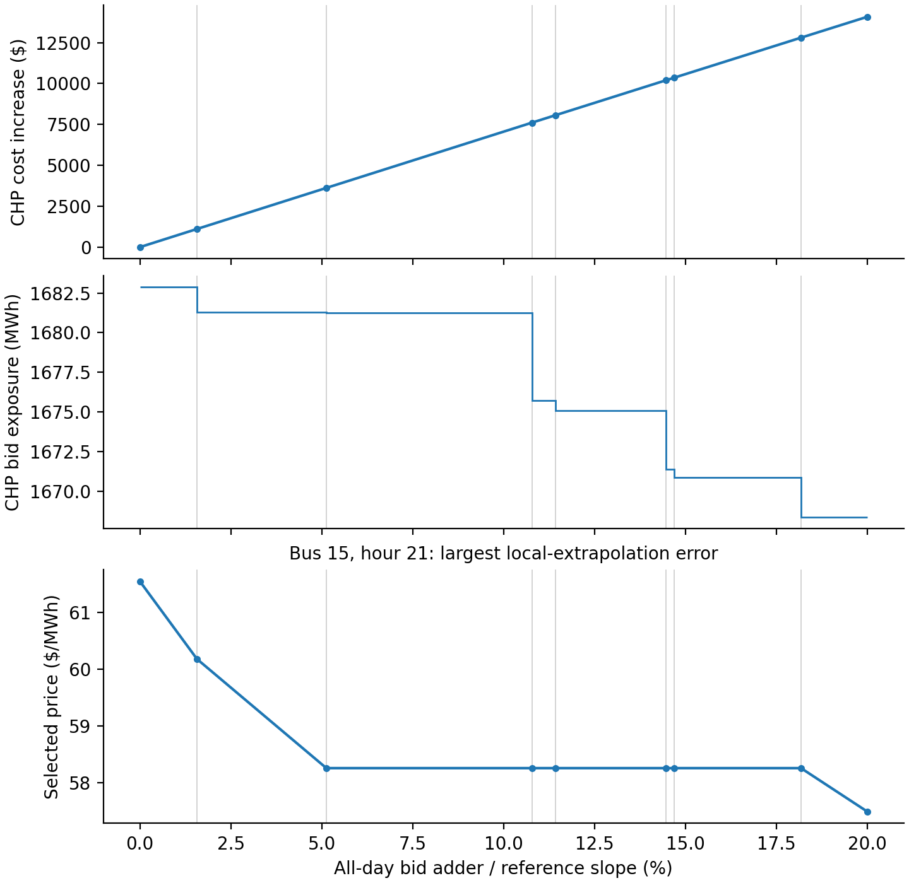
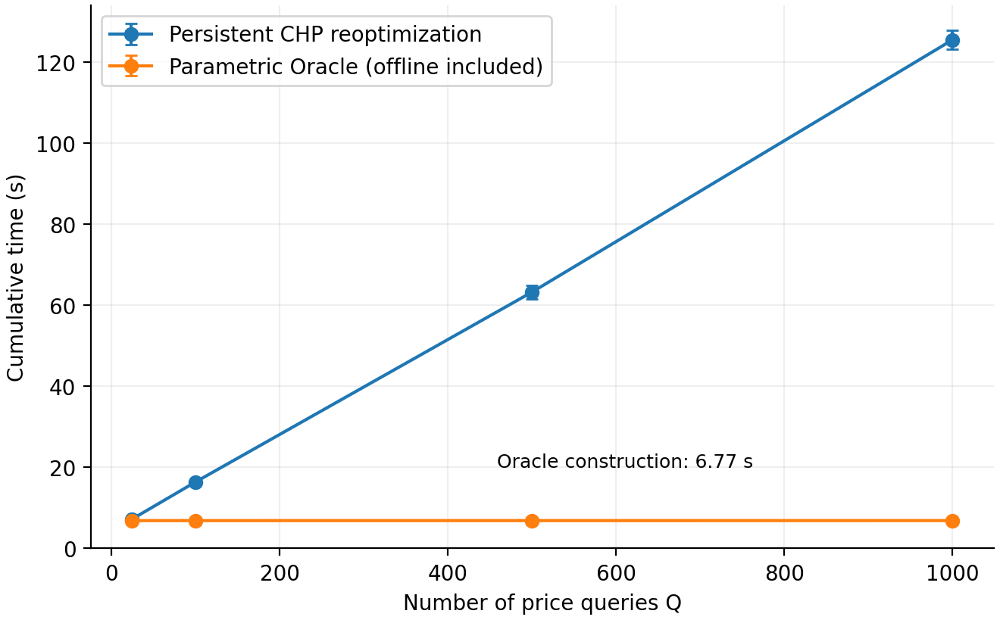
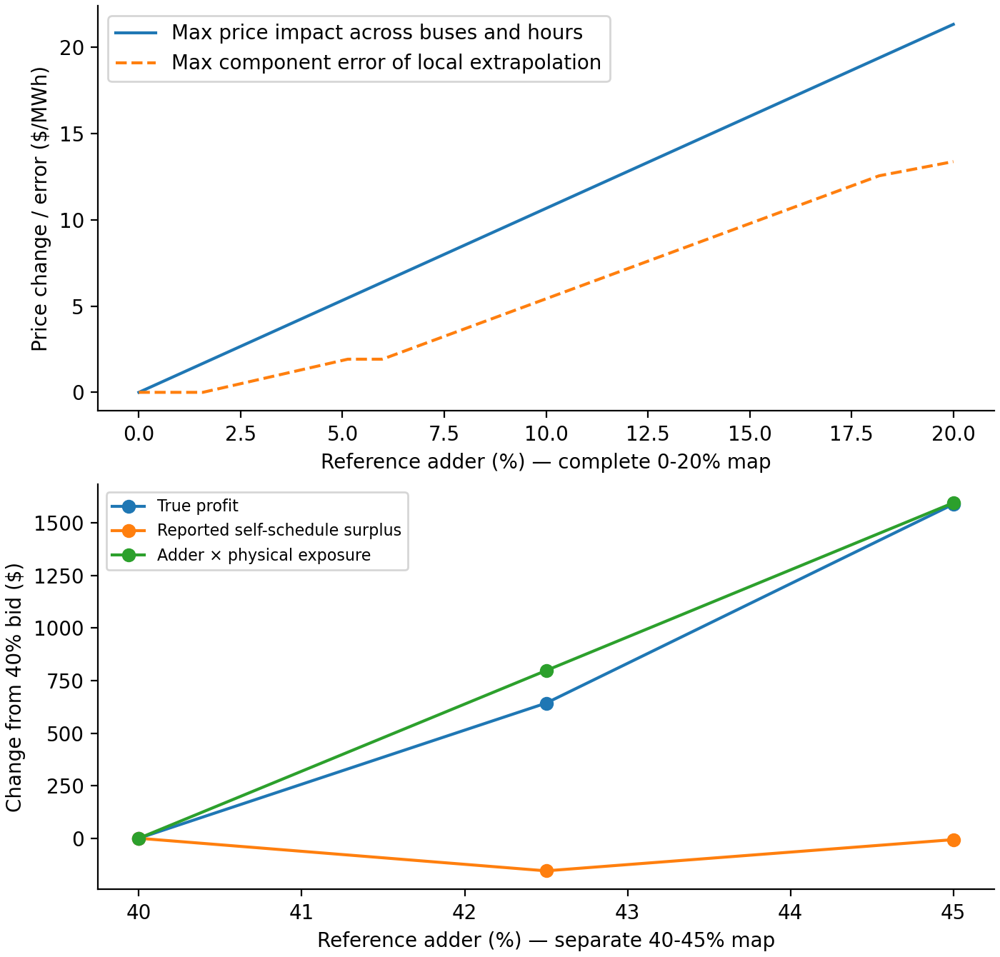

# 参数化 CHP Oracle：区域发现、计算摊销与有限报价范围市场力

实验批次始于 2026-10-15，本文更新至 2026-10-16。详细 formulation 和实验安排见 [算法方案](PARAMETRIC_ORACLE_ALGORITHM_20261015.md)。本文只围绕三项论文实验组织结果：能否建立完整响应图、何时值得预计算、完整图能提供什么市场分析能力。

## 1. 研究目标和方法直觉

固定负荷、网络、机组物理参数和其他报价，只改变一台机组的全日统一报价加数：

\[
v_g(\delta)=\min_{x\in\mathcal P}(c^0+\delta d_g)^\top x,
\qquad \delta=\rho s_g^{ref}.
\]

其中 \(d_g^\top x=\sum_t(p_{gt}-P_g^{min}u_{gt}^{ch})\) 是高于最小出力的凸化电量暴露。价值曲线的斜率对应这一暴露量；节点价格来自完整 LP 对偶。研究服务于同一市场实例下的大量报价分析，改变负荷、网络或报价方向后通常需要重建地图。

一个可行原始解对应一条随报价变化的成本直线。只要它在区间两端都最优，原始可行解的上界与对偶端点弦的下界就把整段价值夹成同一直线。两端完整最优对偶可以随报价插值，从而规定一条合法的节点价格路径。实现保存全部约束及变量界乘子，而不只保存节点价格。

本轮在这个统一框架中实现两种边界发现策略：

1. **上下界细分（bracket-and-certify）**：在数值价值间隙最大的未开放区间继续求解，再检查共同原始解。
2. **原始解有效区间扩张（optimality-region expansion）**：取得一个原始最优解后，固定它，通过两个辅助 LP 直接求它仍然最优的左右报价边界。

第二种策略保留两种等价 formulation：完整对偶加强对偶等式；以及利用互补性消去松弛约束的零乘子、保留全部活动法向量的形式。后者是固定原始解的完整法锥，不是挑选一个 simplex basis。数值活动阈值为 `1e-8`，所得结果仍须通过未缩减 LP 的完整 KKT 审计。辅助问题未最优或审计未通过时，保留已求得点并继续细分。

两种策略均可使用同一个持久 CHP 模型：建立一次 LP，缓存固定矩阵与参数方向，每次只更新目标，并重新提取全部原始解、行对偶、约化成本和原始节点价格。持久模型是公平实现条件；一般参数 LP 的共同原始解、最优性区域和对偶插值性质应归属于已有理论。本文要建立的价值是完整网络 CHP 上可复用的连续报价响应算法及其市场分析能力。

## 2. 实验 A：参数结构能否被完整发现？

两个案例均使用 24 小时、三段成本、tight PTDF、COPT 8.0.6 simplex，LP 可行性和对偶容差为 `1e-9`。6-G2 的参考斜率为 11.999875，30-G1 为 41.982 美元/MWh。

完整建图结果如下。离线时间包含构造过程中模型调用、解提取、完整审计和阶段性归档；查询文件后处理另有独立计时，在实验 B 中计入总时间。

| 案例、范围 | 构造策略 | 主 CHP LP | 辅助 LP | 完整覆盖 | 价值区间 / 选价区间 | 离线时间 |
|---|---|---:|---:|---:|---:|---:|
| 30-G1，0–20% | 每点重建模型的细分 | 15 | 0 | 100% | 8 / 8 | 65.82 s |
| 30-G1，0–20% | 持久模型细分 | 15 | 0 | 100% | 8 / 8 | 6.77 s |
| 30-G1，0–20% | 持久模型 + 完整活动法锥扩张 | 8 | 12 | 100% | 8 / 8 | 9.40 s |
| 6-G2，0–10% | 持久模型细分 | 125 | 0 | 100% | 63 / 65 | 49.74 s |
| 6-G2，0–10% | 持久模型 + 完整活动法锥扩张 | 63 | 122 | 100% | 63 / 65 | 58.09 s |

这张表支持两项明确判断。持久模型显著减少重复建模成本；直接有效区间扩张减少主 CHP 次数，但辅助 LP 也有代价，因此不能把较少的主 CHP 次数等同于更短总时间。本轮默认继续采用持久模型细分，区域扩张作为同一框架中的可选策略。未经消元的完整对偶辅助 LP 在 30-G1 上用时 30.44 秒；完整活动法锥形式将这一时间降至 9.40 秒，说明辅助问题的表示也直接影响构造成本。

6-G2 的两个完整价值地图均为 63 段，在两图全部价值端点上比较，最大价值差约 \(6.55\times10^{-11}\) 美元，最大对应边界差约 \(3.09\times10^{-11}\) 美元/MWh。30-G1 两图均为 8 段，价值差约 \(1.16\times10^{-10}\) 美元。这为“同一理论、两种边界发现策略”提供了直接数值证据。

因此，现在可以在当前实例和容差下说：6-G2 的这个报价方向具有较密的价值结构；此前仅凭 40 点预算耗尽还不能得出这个结论。6 节点与 30 节点的区间数差异来自不同参数问题，不由网络节点数排序决定。6-G2 的 65 个价格区间对应各自已声明的合法选择路径，不能称为所有 CHP 最优价格都必然具有的 65 种机制。

已有地图复用也完成了受控对照：同为 40 个总归档 CHP 点，6-G2 从大范围两端开始的细分尚未开放整段价格；以旧 `[0,0.1]` 小地图为初始图扩展，保留原来已开放的选价路径后达到约 **29.13%** 的范围长度覆盖。其总离线成本为 25.43 秒，其中继承旧地图成本 16.81 秒、新增约 8.62 秒，不能省略前者。120 点细分试验达到 99.15%，随后单独保留的新完整运行在 125 点终止；各版本均保存，不改写旧结果。

主结果图：

图 A：上两幅分别是价值增加量和价值斜率；下幅选择全报价范围中相对基线局部导数外推误差最大的节点—时段（节点 15、第 21 小时），展示非线性的分段选价响应。灰线是价值区间边界，不表示每条都必然对应此单个价格分量的折点。所有节点—时段的价格数组仍完整保存。

两系统的主地图均配有独立 CHP 重优化与完整插值对偶复核，30-G1 包括每个计算区间内部及端点两侧邻域。区域扩张的 6-G2 地图另有 176 个独立内部点通过，最大插值对偶差约 \(9.46\times10^{-11}\) 美元。完整见证、辅助 LP 记录与残差在结果目录，正文不将这些质量检查拆成独立贡献。所有区间主张均为 **numerically validated under COPT optimality and declared tolerances**，并非符号精确证书或统一价格误差界。

## 3. 实验 B：预计算何时能被重复查询摊销？

主要比较同一数学模型和求解精度下的持久 CHP 重优化与参数化 Oracle。离线主图采用 30-G1 0–20% 的持久细分结果。预先固定均匀内部报价并用种子 `20261015` 打乱顺序；每档实际运行 3 批，基线每批都新建一个持久模型并计入初次求解。

\[
T^{oracle}_{total}(Q)=T_{offline}+T_{postprocess}+T_{load}+T_{query}(Q).
\]

下表单位均为秒。重优化列为三批均值 ± 样本标准差；Oracle 的离线建图本轮计时一次并计入每批总时间，批间变化只反映加载与在线查询，不代表完整离线构造的方差。

| 乱序查询数 | 持久 CHP 重优化 | Oracle 含离线、后处理和查询 | 累计时间比（重优化 / Oracle） |
|---:|---:|---:|---:|
| 24 | 7.13 ± 0.27 | 6.80 | 1.05 |
| 100 | 16.36 ± 0.48 | 6.80 | 2.41 |
| 500 | 63.23 ± 1.71 | 6.81 | 9.29 |
| 1000 | 125.48 ± 2.39 | 6.81 | 18.43 |

24 次时两者接近，当前测量不提供精确保本次数；100 次及以上出现清楚的累计时间优势。结果不再依赖“每个报价重建模型”的弱基线。不同机器、线程设置、查询负载和其他机组仍需分别计时，不能把本实例阈值写成普遍结论。

图 B：四档数据均为实际乱序批次；连线仅帮助阅读，不是中间查询次数的实测。误差条对应三批波动，Oracle 曲线含一次实测离线成本。30-G1 主图的完整见证约 1.05 MB，在线查询文件为 9,026 字节；两种空间用途分别报告，不把删除见证载荷的全部降幅都归因于区间合并。

该速度比针对 CHP 定价查询。完整战略利润评估还包含物理 UC 和单机自调度，不由这些计时自动获得同倍加速。

## 4. 实验 C：完整图能提供什么连续范围分析？

在声明的选价规则下，定义

\[
V_g^{range}=\max_{\delta\in[0,\bar\delta]}\max_{n,t}
|\lambda^{sel}_{nt}(\delta)-\lambda^{sel}_{nt}(0)|.
\]

每个价格区间内，绝对仿射价差的最大值是凸函数，最大值可在该区间端点取得。因此无需再解上千个 CHP，只检查主图的 **9 个价格端点**，便得到 30-G1 0–20% 连续范围中的

\[
V_g^{range}=21.3182363\ \$/\mathrm{MWh},
\]

在 20% 加数、节点 15、第 1 小时达到。这是所选合法价格路径上的极值，不是所有对偶最优价格中的最坏情形。

本例局部右导数外推恰好也给出相同的全网最大价差，不能据此宣称局部方法低估该最大指标。然而，完整价格向量中，局部外推最大误差达到 **13.3675 美元/MWh**，位于节点 15、第 21 小时。该价格从零加数时的 61.5493 变为 20% 时的 57.4946 美元/MWh，中途经历斜率变化。一个总体最大值相同，不代表各节点—时段的有限报价响应都能由局部 Jacobian 重建。

经济解释使用单独建立的 30-G1 **40–45%** 局部 Oracle，固定其选价规则，分别重求三个报价下的物理 UC 和申报自调度。0–20% 地图不覆盖这三个经济报价。根据申报 LOC uplift 结算并使用真实成本，得到：

| 参考加数比例 | 真实利润 \(\Pi^{true}\) | 最大申报自调度盈余 \(M^{rep}\) | \(\delta D^{UC}\) |
|---:|---:|---:|---:|
| 40% | 35,879.68 | 23,115.53 | 12,764.15 |
| 42.5% | 36,522.52 | 22,960.60 | 13,561.91 |
| 45% | 37,468.67 | 23,109.00 | 14,359.67 |

三点均满足 \(\Pi^{true}=M^{rep}+\delta D^{UC}\)，最大会计残差约 \(1.64\times10^{-11}\) 美元。三点的物理暴露均约 760.10 MWh；40%→45% 时，报价楔子收入增加约 1,595.52 美元，自调度盈余净减少约 6.53 美元，真实利润增加约 1,588.99 美元。该恒等式依赖所声明的 LOC uplift 与成本加数定义，不是 CHP 独有定理。

图 C：上图分别画全网最大价格变化与完整向量的最大局部外推误差，两个曲线含义不同；下图为单独 40–45% 局部地图下三次直接 UC/自调度结算相对 40% 的变化，连线仅为视觉指引。没有据此证明整个 40–45% 物理 UC 恒定、利润仿射，或报价端点就是利润最优策略。

## 5. 论文定位、实现与后续

当前最连贯的论文逻辑是：固定市场条件下的大量有限报价查询需要完整响应；共同原始解与完整对偶支持区域表示；持久模型和两种边界策略使图可以实际构造；分段结构既减少重复定价优化，也直接支持适用指标的连续范围极值分析。市场力层通过真实 UC、自调度和 LOC 会计解释价格影响何时成为收益。

既有 Yu/Pan interval/DAG 表示、一般参数 LP 理论、局部 CHP Jacobian 与已有利润型市场力定义应正确归功于前人。本文不把“价值函数分段仿射”“查表比求 LP 快”或“一个最优对偶选择”单独包装为创新。值得形成论文贡献的是完整网络 CHP 的区域发现、复用与可审计选价，以及这种表示带来的有限范围分析能力。

| 研究功能 | 当前代码 |
|---|---|
| 持久 CHP 目标更新及完整解刷新 | `price_vulnerability/persistent_chp.py` |
| 上下界细分、旧图扩大范围 | `price_vulnerability/budgeted_oracle.py`、`run_affine_oracle.py` |
| 完整对偶 / 活动法锥有效区间 LP | `price_vulnerability/optimality_region.py`、`run_region_oracle.py` |
| 独立价值地图与原路径价格压缩 | `postprocess_oracle.py`、`price_vulnerability/oracle_compression.py` |
| 固定乱序负载、实际价格提取、重复批次 | `benchmark_oracle_queries.py`、`run_oracle_paper_study.py` |
| 连续范围价格极值 | `price_vulnerability/range_vulnerability.py` |
| 完整插值对偶独立复核 | `validate_affine_oracle.py` |

完整结果表及两策略价值图的一致性记录见 [算法统计](results/parametric_algorithm_20261015/tables/structure_comparison.json)，实际三批计时见 [计时汇总](results/parametric_algorithm_20261015/timing/timing_summary.json)，价格极值与结算见 [范围指标](results/parametric_algorithm_20261015/application_final/range_price_impact.json)和[结算记录](results/parametric_algorithm_20261015/application_final/economic_settlements.json)。图同时保存 PNG 和 PDF。

后续优先将以上三项实验写入论文，完善相关工作归属与方法伪代码。若继续增强算法，应围绕区域辅助 LP 的总成本、可复用证书和更多明确报价方向的比较，不再扩大无关诊断或节点规模来替代算法论证。性能的下一项必要补充是重复离线构造本身并报告波动；当前三批性能已经充分支持所测固定图下的重复查询比较。
