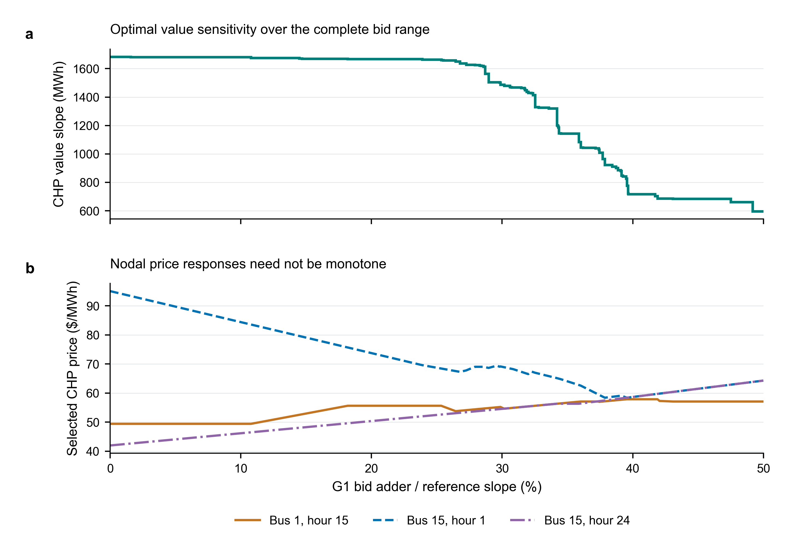
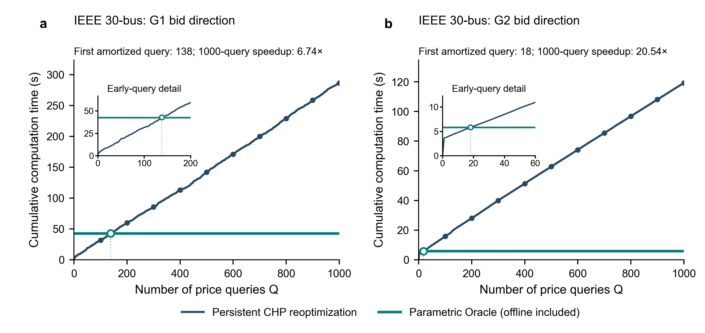
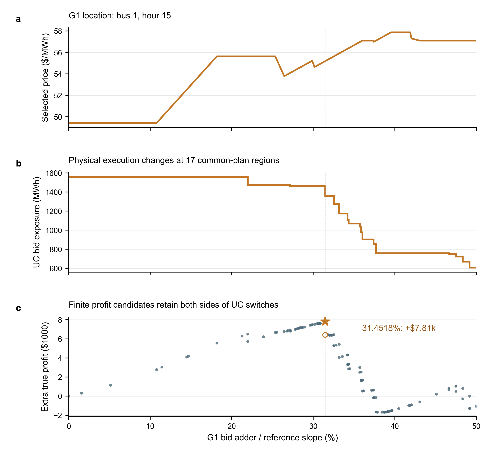
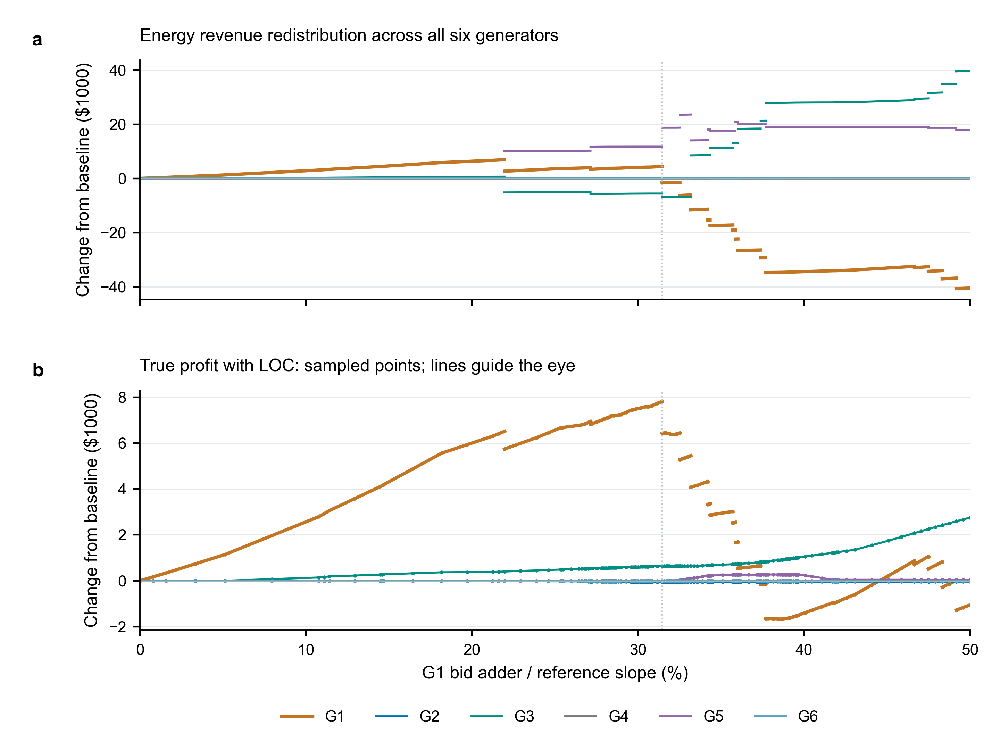
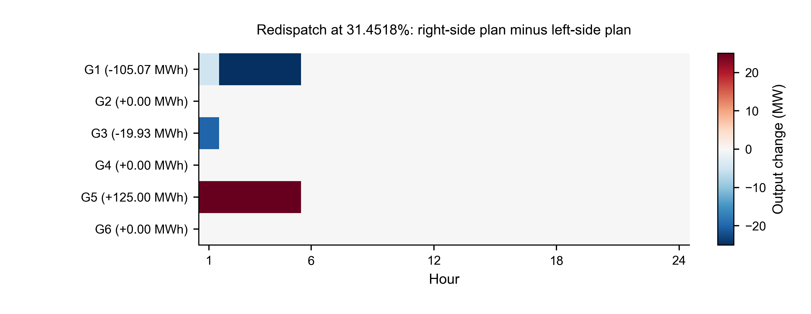

# 参数化 CHP：论文图表与源数据

## 使用建议

正文建议采用 **Fig.1–3 + 一张建图主表**，收益分配与边界逐小时再调度作为补充图。它们分别回答：连续报价响应能否被有限表示、离线计算何时值得、这种结构如何用于识别有利报价。只包含30/118节点，不新增6节点结果。

每图均提供可编辑文本的PDF/SVG和400dpi PNG预览。CSV是实际求解或已验证映射的导出，不是示意数据。所有统计与源数据口径见下文。

快速浏览：[五张图的合并PDF](all_figures.pdf)。

## Fig.1 — Complete parametric CHP response



**建议图注（英文）：** Complete selected-price response to the G1 bid adder in the IEEE 30-bus system. (a) The CHP optimal-value slope with respect to the absolute marginal-cost adder, in MWh, obtained from the saved common-primal witnesses. The horizontal axis is the adder normalized by the reference slope, not the differentiation variable. (b) Three representative nodal-hour prices from the fixed continuous piecewise-affine dual selector. The full 0–50% range contains 78 value regions and 83 selected-price segments. Nodal prices need not increase monotonically with the strategic offer. All claims concern the declared selector and numerical tolerances, not uniqueness of optimal CHP prices.

**怎样读：** 上图下降的不是系统总成本，而是“再增加一点报价时，系统成本增加得有多快”。下图说明它不能被直接当成每个节点电价的导数。三条价格曲线分别代表战略节点、显著下降及上升响应；从全部30×24价格分量中按这些经济角色选择3个，其余不在这张代表图展示，但原完整价格矩阵保持归档。

源数据：`figure1_value_slopes.csv`、`figure1_selected_prices.csv`。归一化定义为δ=41.982ρ，因此对ρ求导时需再乘41.982。

## Fig.2 — Measured cumulative computation time



**建议图注（英文）：** Cumulative pricing costs for the G1 and G2 bid directions in the IEEE 30-bus system. Each panel uses one predeclared stream of 1,000 equally spaced interior offers in shuffled order, with the same normalized offers and seed for both directions. All integer-query prefixes are measured; markers are shown every 100 queries. Persistent CHP includes its initial model setup, objective updates, optimization, and raw-price extraction. The Oracle includes the archived offline construction, postprocessing, file loading, and measured online queries, making its curve nearly horizontal. Insets resolve the early-query intersections. The first observed amortized queries are Q=138 and Q=18, respectively; these are workload-specific single-run observations, not universal break-even thresholds. Physical UC discovery and profit settlement are excluded from this pure pricing comparison.

| 当前前缀批次 | Q=1000持久重优化 | 含离线Oracle | 比值 | 首个实测摊销点 |
| --- | ---: | ---: | ---: | ---: |
| 30-G1 | 286.46 s | 42.52 s | 6.74× | 138 |
| 30-G2 | 119.28 s | 5.81 s | 20.54× | 18 |

本轮种子20261018。旧独立整批结果6.50×/19.87×保留，不与本轮前缀计时拼接，也不以本轮替换成“更好”的算法结果。时间差来自不同实测批次；这里增加计时只为取得真实累计曲线。没有构造虚假的重复样本、标准差或置信带。

118-G11仍报告已实测的Q=200：278.06 s对311.60 s，尚未摊销。没有为它外推或追加一个看起来有利的交叉点。

源数据：两个`trace_30_*_q1000.json`、`figure2_measured_prefixes.csv`、`table_cumulative_checkpoints.csv`、`timing_crossings.json`。曲线是同一查询流前缀，不是每100次重新冷启动一个独立批次；绿色近似水平线仍包含实际在线累积开销。

## Fig.3 — Finite-range profitable bidding



**建议图注（英文）：** Selected-price response, physical offer exposure, and finite profit candidates for G1 in the IEEE 30-bus system. (a) A representative price at the strategic generator's bus. (b) Above-minimum physical energy exposure in the 17 common optimal-plan regions. (c) True-profit increments at the finite joint-region endpoints, retaining both adjacent physical plans at UC switches. The star marks the numerical upper-boundary candidate near 31.4518%, with an additional profit of $7,811.56 relative to truthful bidding. The hollow marker is the alternative optimal physical execution at the same bid and price. Profit points are not connected as an exact response curve. The attained boundary maximum uses the declared optimistic dispatch tie-break; the exact-model supremum interpretation requires the stated continuity and optimality assumptions.

**怎样读：** 报价持续提高时，价格可以连续变化，但物理执行会切换。G1在最重要边界的增量电量暴露减少约105.07 MWh，申报最佳自调度盈余连续，而δD减少约1387.35美元，因此真实利润可能向下跳变。星号是声明边界选择下的最大候选，也是精确理论利润上确界的数值估计；不是任意物理选择必然取得的同一个最大值。

候选数据来自上一轮完整0–50%报告，不重新以绘图样本寻找最优报价。33次UC发现17个物理区域，与83个价格区间形成99个联合区间，100个不同端点报价对应116条报价/方案候选。

## Fig.S1 — Revenue and profit redistribution across generators



**建议图注（英文）：** Payoff redistribution across the six generators of the IEEE 30-bus system as only G1 changes its offer. (a) Energy-revenue changes relative to truthful bidding. Revenue is affine within each fixed physical-plan and selected-price intersection. (b) True-profit changes including reported LOC uplift, evaluated by direct single-unit self-scheduling at every joint endpoint and midpoint. Profit lines are guides between directly evaluated samples, not an exact piecewise-affine reconstruction. Separate branches are plotted for different physical regions, preserving dispatch-induced jumps. All generators use the same full-system physical plan and CHP price selector; other units retain truthful costs. The vertical line marks G1's best boundary candidate.

这里的“六台机组”是30节点系统中的六台发电机，不是6节点系统。

所有99个联合区间的端点及中点均用于结算，共199个不同报价、1194次单机自调度求解；物理边界的两个方案分别保留，最终1290条机组结算记录。增加这些内部点是为了画清收益分配，不是原有限候选最大化方法所必需的求解成本。

**最有解释价值的对照：** 在G1最有利报价的声明物理方案下，相对真实报价，G5的能量收入增加约11707.21美元，但真实利润仍约为零；G3能量收入减少约5592.77美元，真实利润反而增加约640.92美元。这都符合统一的申报LOC补偿与真实成本核算，不能仅凭能量收入判断获利。完整数值见`table_generator_payoffs_at_G1_best_bid.csv`。

## Fig.S2 — Physical redispatch at the profitable boundary



**建议图注（英文）：** Hourly physical redispatch at the G1 profit boundary near 31.4518%, computed as the right-side common optimal plan minus the left-side plan. The full set of six generators and 24 hours is retained. During hours 1–5, G5 becomes online and supplies an additional 125 MWh, while G1 and G3 reduce generation by 105.07 and 19.93 MWh, respectively. Hourly power balance is preserved. The saved plans have unchanged numerically active line-hour sets; the figure establishes a commitment and dispatch change, not a causal attribution to a newly binding line.

**经济直觉：** 右侧组合的真实系统成本比左侧高1387.35美元，但G1少发105.07 MWh使申报加价成本下降同样的金额；两者在该报价恰好抵消，形成申报UC成本线的交点。因此更高报价可能诱导另一台机组提前开机并替代战略机组的电量，而非持续提高战略机组利润。

### 边界收益分解表：右侧减左侧，单位美元（电量除外）

| 机组 | 电量变化/MWh | 能量收入变化 | LOC变化 | 真实成本变化 | 真实利润变化 |
| --- | ---: | ---: | ---: | ---: | ---: |
| G1 | −105.07 | −5898.58 | +94.33 | −4416.90 | −1387.35 |
| G2 | 0 | 0 | 0 | 0 | 0 |
| G3 | −19.93 | −1258.75 | +108.25 | −1150.50 | 0 |
| G4 | 0 | 0 | 0 | 0 | 0 |
| G5 | +125.00 | +6979.91 | −25.16 | +6954.75 | 0 |
| G6 | 0 | 0 | 0 | 0 | 0 |

相同价格下，非战略机组的真实利润等于其最佳申报自调度盈余，不依赖这两个物理最优执行之间的选择；发电、收入、成本、LOC则可以变化。G1多出δD项，故利润跳变。舍入前完整表为`table_boundary_redistribution.csv`，每小时数据为`boundary_hourly_redispatch.csv`。

## 正文主表建议

| 实例 | LP变量 | LP约束 | CHP求解点 | 价值区间 | 选价区间 | 离线/s |
| --- | ---: | ---: | ---: | ---: | ---: | ---: |
| 30-G1 | 20717 | 69923 | 154 | 78 | 83 | 41.96 |
| 30-G2 | 20717 | 69923 | 15 | 8 | 8 | 5.77 |
| 118-G11 | 198068 | 648378 | 205 | 103 | 103 | 309.72 |

这里统一报告实际用于该Oracle成本核算的单次归档建图；若正文改用G1三次均值41.79±0.18秒，应明确其余两行为单次，且累计图仍使用其实际对应地图的离线成本。三者均为24小时、三段增量成本、tight PTDF、0–50%统一参考加价，完整数值覆盖。主表不把选价分段称为唯一经济机制，也不推导区间数随网络规模的增长规律。CSV见`table1_oracle_construction.csv`。

## 复现与质量检查

绘图入口为`make_research_figures.py`，设计与主旨见项目的图表设计文档。以下使用新目录；每条大型计时按顺序执行，不与其他优化并行：

```powershell
python benchmark_oracle_queries.py --oracle-dir results/scope_study_20261016/30_bracket_repeat1 --queries 1000 --skip-fresh --order shuffled --seed 20261018 --record-trace --output results/new_figures/trace_30_G1_q1000.json
python benchmark_oracle_queries.py --oracle-dir results/targeted_study_20261016/30_G2_bracket_0to50 --queries 1000 --skip-fresh --order shuffled --seed 20261018 --record-trace --output results/new_figures/trace_30_G2_q1000.json
python make_research_figures.py --stage prepare --out-dir results/new_figures
python make_research_figures.py --stage render --out-dir results/new_figures
```

如需重画本归档，不需重新求解：直接对当前目录执行`--stage render`。可选`--qa-tools`指向已安装的图形审核工具目录，以运行同一最终绘制布局检查；没有该参数时可渲染，但不声称新渲染通过了外部QA。正式导出后还应检查PDF实际字号和文字碰撞。

本轮最终PDF最小字号为6.5pt（累计图局部放大窗），其他图最小8pt；多面板绘图区通过1.5pt对齐门槛。累计图的嵌入局部放大窗和热图色条不属于全局等宽面板比较，分别按局部可读性检查。PNG是400dpi预览，投稿使用矢量PDF/SVG；没有必要为纯线图强制提供更大的TIFF。

全部原始查询时间前缀、结算数据、物理来源和报告摘要均保留。局部图形QA及复现材料中的数值残差不进入主文图注主叙事。既不修改旧价格选择，也不将这次补算各机组绘图样本的成本混入原17.65秒的有限候选策略评价。
