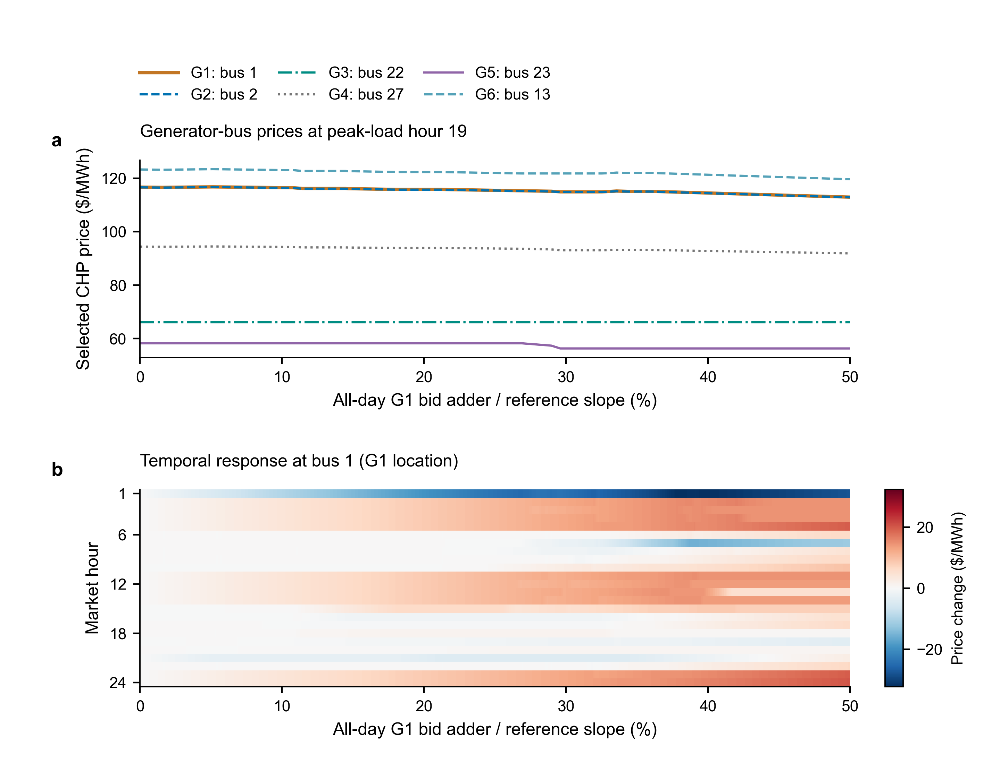
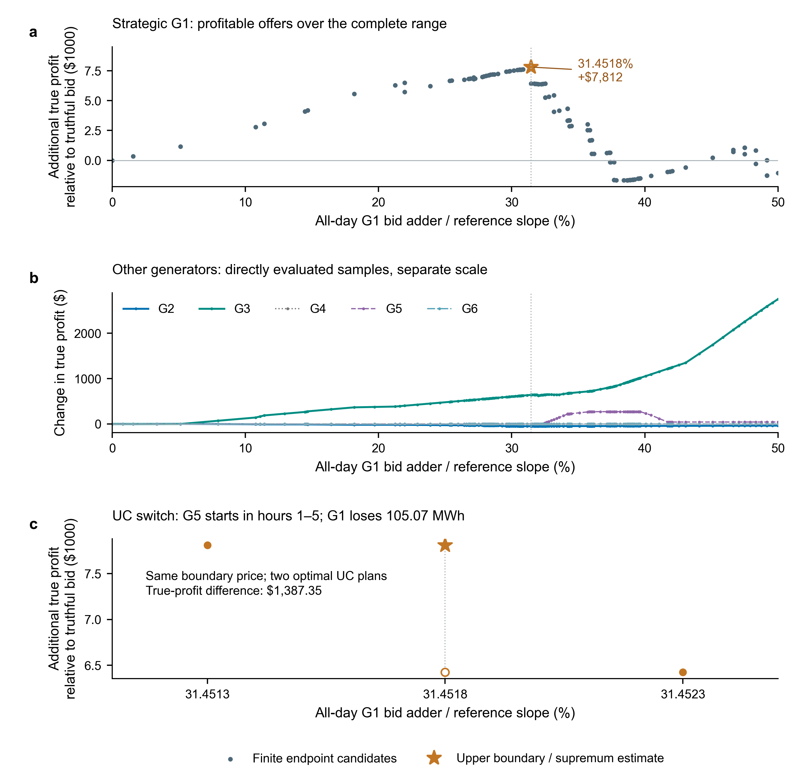

# 2026-10-17 研究收敛：初态、价格展示与单小时结算

完整目的、方法及理论口径见 [研究说明](../../FINALIZATION_STUDY_20261017.md)。前版 [20153f8 图表](../presentation_revision_20261016/README.md)及其源数据原样保留；本版没有覆盖旧价格地图或修改旧计时。

## 成果入口

- [全部五张图 PDF](figures/all_figures.pdf)：三张主图、两张补充图。
- [初态与 CHP/UC/结算一致性数据](initial_audit/initial_condition_audit.json)：30 节点 3 个报价点、118 节点 1 个报价点及单小时两端；全部机组实际初态和完整结算记录。
- [单小时经济延伸](localized_economics/localized_economic_followup.json)：复用原两个 UC 端点，仅增加 1 个交点 UC，形成 2 个共同物理区域及 4 条目标机组候选。
- [Table I 建图规模](figures/table1_oracle_construction.csv)、[Table II 六机组结算差值](figures/table2_settlement_decomposition.csv)、[Table III 市场力汇总](figures/table3_market_power_summary.csv)。
- [附表：绝对结算金额](figures/tableA1_absolute_settlements.csv)，保留真实报价和最有利候选的全部收入、LOC、真实成本与利润。

## Fig.1 — Absolute prices and temporal price changes



**建议英文图注：** Selected CHP prices under a common all-day G1 offer adder in the 30-bus system. (a) Absolute prices at all six generator buses in the baseline peak-load hour (hour 19, 289.2 MW). Only the physically motivated start hour and the load-peak hour were compared using the saved map; the peak hour separates price levels more clearly, while the G1/G2 curves remain nearly coincident. (b) Price changes at bus 1 across all 24 market hours, relative to each hour's own truthful price. The offer changes all hours, not only the observed hour. Heatmap cells sample the archived affine selector at their centers. Prices belong to one declared numerically validated optimal dual selection; the panels do not identify a specific causal network/ramping constraint or establish price uniqueness.

小时选择比较源数据为 `figures/hour_selection_comparison.csv`，仅包含小时 1 与系统峰值小时 19。上图不再将六条价格各自归零；下图继续用价格变化区分不同时段的响应方向。非发电节点 15 退出主图，补充值见 `figures/supplementary_bus15.csv`，小时 1 最大降幅约 36.67 美元/MWh。旧小时 1 曲线完整保留在前版目录。

## Fig.2 — Repeated CHP pricing, not whole-market simulation speedup


**建议英文图注：** Measured cumulative repeated-CHP-pricing costs under fixed market conditions. The two 30-bus streams contain 1,000 queries each and the 118-bus stream contains 200; all integer-query prefixes were measured within their respective single shuffled streams. Persistent reoptimization includes initial model setup, objective updates, optimization and raw-price extraction. Oracle costs include archived construction, postprocessing, loading and online lookup. The first observed amortized queries are 138 and 18 for 30-G1 and 30-G2. The 118-G11 stream is not amortized within 200 queries; no crossing is extrapolated. These are pricing timings, excluding physical UC and self-scheduling MILPs used for profit analysis. Changes in load, network, initial states or other fixed market inputs generally require rebuilding or revalidating a map.

本版原封不动使用已记录的三条查询流，不补算或择优替换速度比：30-G1 为 6.74×，30-G2 为 20.54×，118-G11 为 0.90×。源流分别位于前两轮目录，`figures/input_manifest.json` 记录实际文件版本。

## Fig.3 — Additional strategic profit and effects on other units



**建议英文图注：** True-profit effects of the all-day G1 offer adder. (a) Additional G1 profit relative to truthful bidding at all finite joint-region endpoint candidates. Baseline total true profit is $37,289.31; the upper-boundary candidate near a 31.4518% reference adder yields total profit of $45,100.87 and an increment of $7,811.56 (20.95%). The percentage is a normalized offer, not a price rise or profit margin. (b) Changes in the other five generators' profits; these units do not change their own offers. Samples are directly settled and connecting lines only guide the eye. (c) Direct neighborhood checks and both adjacent optimal UC plans at the same boundary bid and selected price. Markers, without an assumed analytic profit branch, distinguish physical execution alternatives. The upper and lower boundary profits differ by $1,387.35 as G5 starts in hours 1–5 and replaces G1/G3 energy. Attainment depends on the UC tie rule; the exact-model supremum interpretation is conditional on the stated selector, optimality and settlement assumptions.

Fig.3(b) 不解释为收益零和转移，也不将其他机组的利润变化称为它们自己的策略操纵收益。审计在边界重新求 UC 返回了原报告中的低侧方案，故其 G1 利润 43,713.52 美元；Table II 仍采用原声明上侧方案，不混排两种执行。

## 补充材料及新经济结果

S1 保留价值斜率、物理 UC 暴露与利润组成的区别。S2 定位为 **Bid-Direction Dependence of Parametric CHP Responses**：全日统一方向与小时 1 方向使用相同价格变化色标，后者的选价没有可分辨变化；不是证明不存在时间耦合。

单小时 UC/LOC 小核查发现，在加数 19.584 美元/MWh（参考斜率的 46.6486%）有物理方案切换。G1 第 1 小时增量出力从 40 降为 34.9304 MWh。两个共同 UC 区域的四条候选表明，在当前选价与物理方案规则下，完整 0–50% 范围的最大额外利润约为零；50% 时真实利润为 37,182.90 美元，比基准少 106.42 美元，LOC 则由 594.61 增为 732.67 美元。

此结论由共同物理方案端点的全局 UC 界和区间利润凸性支持，不是两次收益采样的猜测；原两端无共同方案时，先只补一个交点，并未扩大为新的全天小时搜索或多维战略优化。候选见 `localized_economics/localized_profit_candidates.csv`。没有跨所有合法选价/物理并列解声称相同最大值。

## 模型身份与复现

当前采用明确的冷启动初态：全部 30/118 节点机组均初始离线、出力零、最小停机时间已满足；未运行前一天预热 UC。机组全部参数与负荷/PTDF/线限/节点映射参与模型数据指纹。新构建自动记录；四个主要旧地图使用 `model_identity.json` 追溯侧文件，不改原见证。侧文件说明其来自本轮代表点复算，不是历史同时记录或对所有旧见证的重新证明。已绑定模型不匹配时拒绝混用，继承未绑定旧见证也会被拒绝。

复现新增计算应依次运行，输出用新目录：

```powershell
python run_initial_condition_audit.py --out-dir results/new_finalization/initial_audit
python run_initial_condition_audit.py --audit-dir results/new_finalization/initial_audit --out-dir results/new_finalization/localized_economics
python revise_research_figures.py --out-dir results/new_finalization/figures
```

当前绘图脚本从固定已归档地图、结算与查询流读数；本轮核查输入也固定记录在清单中，因此重画本版不必重跑任何 UC。旧 20153f8 的绘图源需按该提交回放，当前脚本输出的是本次修订版。118 节点完整见证大文件仍按原约定本机保留，不以本轮侧文件宣称 GitHub 已包含它。

图中 PDF/SVG 保留可编辑文字，PNG 为 400 dpi 预览。质量记录见 [QA_NOTES.md](QA_NOTES.md)。
