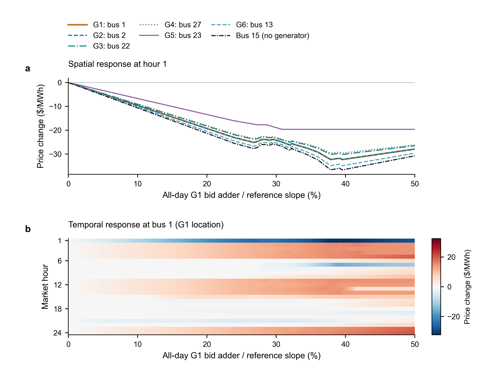
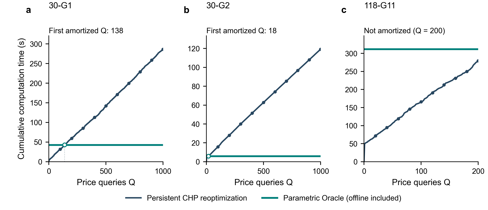
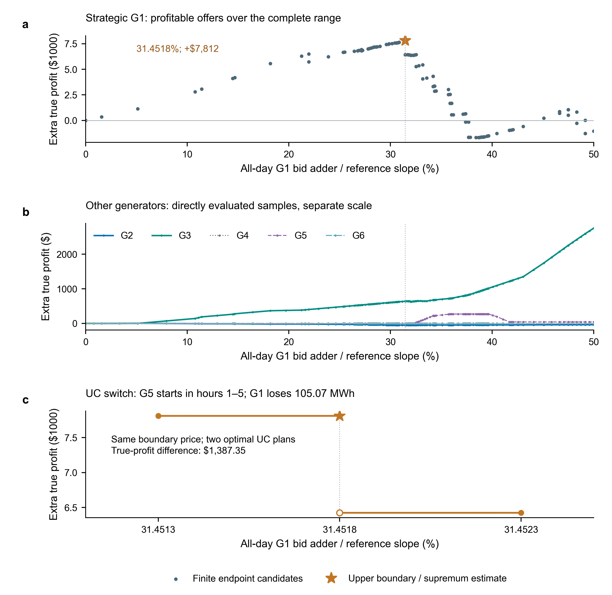
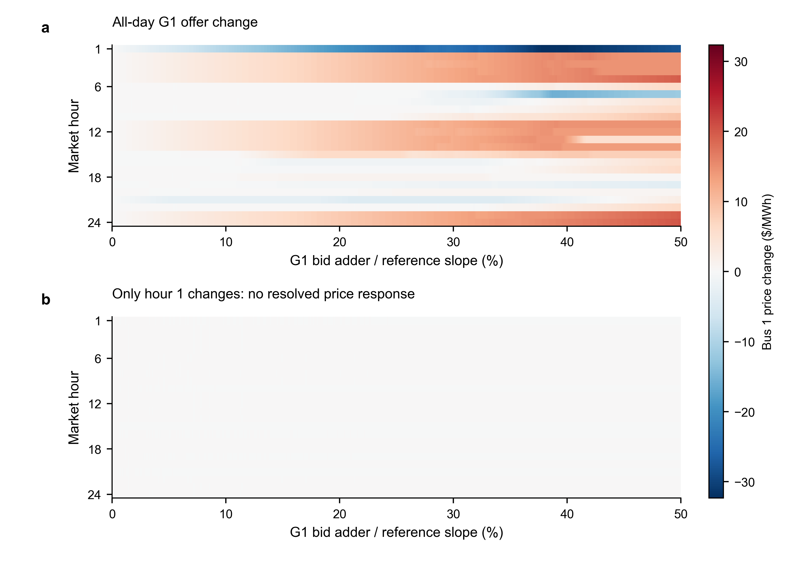

# 参数化 CHP Oracle：价格响应、计算复用与有利报价

本版按后续建议重新组织图表，不修改旧完整地图和利润候选。全文主线为：**构造可复用的连续报价价格映射，用它解释时空价格响应，并结合物理 UC 区域分析可获利报价。**

直接浏览：[五张图的合并 PDF](all_figures.pdf)。每图同时提供可编辑文本 PDF/SVG、400 dpi PNG。详细方案见[图表更新方案](../../FIGURE_REVISION_2026-10-16.md)。[前版图表与全部机组结算、逐小时再调度源数据](../figure_study_20261016/README.md)不覆盖、不删减。

## 一、先把报价定义说清楚

主实验改变的是 G1 在**全部 24 小时、全部增量成本段**的同一绝对加数：

\[
c^{rep}_{G1,t,k}=c^{true}_{G1,t,k}+\delta,\quad
\delta=41.982\rho,\quad 0\le\rho\le0.5.
\]

横轴的 31.4518% 是 \(\rho\) 的百分数，不是利润率。这也不是把每段报价各乘以 \(1+\rho\)。报价加数的目标函数暴露为 \(\sum_t(p_{G1,t}-P_{\min}u_{G1,t})\)。负荷、初态、固定和启停成本、其他机组报价不变。

“观察第 1 小时的价格”与“只改第 1 小时的报价”是不同的实验。Fig.1–3 使用全日报价；只有补充对照使用单小时报价。

## 二、Fig.1 — 空间与时间价格响应



上图固定第 1 小时，保留全部六个发电机节点，并加入无发电机的节点 15 作对照。G1、G2 的响应接近重合，保留两者而不人为放大差异。小时 1 的选择依据是已观察到的前五小时 UC 切换；节点 15 则是已有结果中的显著非发电节点，不称随机代表节点。

下图固定 G1 所在节点 1，展示全部 24 小时。同一全日加价可以对应某些小时价格下降、另一些小时上升。**成本敏感性不等于节点价格敏感性，报价提高也不意味着每个节点、每个小时的价格都提高。** 这些结论针对当前连续合法选价路径，不证明价格唯一，也不证明某一条线路/爬坡约束的因果作用。

**英文图注：** Spatial and temporal selected CHP price responses to a uniform all-day G1 bid adder in the IEEE 30-bus system. (a) Price changes at all six generator buses in hour 1, with non-generator bus 15 as a contrast. The G1 and G2 responses nearly coincide. (b) Price changes at bus 1 over all 24 market hours. Each price is measured relative to the same component at truthful bidding. Heatmap cells evaluate the archived affine selector at their midpoints; the display grid resolves every saved price boundary. The adder acts on all hours, not only the observed hour. Responses describe one continuous optimal dual selection under declared numerical tolerances, not uniqueness of CHP prices or a causal identification of an individual binding constraint.

源数据：`figure1_spatial_prices.csv`；`price_heatmaps.npz` 记录精确查询的显示单元中心、边界与全部 24 小时颜色值。完整 30×24 价格路径仍位于原地图 `../scope_study_20261016/30_bracket_repeat1/compact.npz`。热图是连续仿射映射的有限分辨率展示，不把颜色单元当作真实常值区域。

## 三、Table I — 有限离线地图

| 实例 | LP 变量 | LP 约束 | CHP 求解点 | 价值区间 | 选价段 | 原离线构建/s |
| --- | ---: | ---: | ---: | ---: | ---: | ---: |
| 30-G1 | 20,717 | 69,923 | 154 | 78 | 83 | 41.96 |
| 30-G2 | 20,717 | 69,923 | 15 | 8 | 8 | 5.77 |
| 118-G11 | 198,068 | 648,378 | 205 | 103 | 103 | 309.72 |

三个实例均为 24 小时、PTDF tight 网络、三段成本、归一化 0–50% 范围。各方向参考斜率分别为 41.982、70.8786、36.33 美元/MWh；相同归一化范围不表示相同绝对加数。118 节点沿用等价稀疏聚合出力耦合。G2 的选择来自基准正增量出力在线小时较少的运行特征，而不是事后挑最快结果。

该表报告对应地图实际归档的单次构建，不把不同统计口径混成重复均值。选价段数是所声明选择规则下的有限表示复杂度，不是唯一经济机制数，也不用于推断随系统规模增长的定律。完整表：`table1_oracle_construction.csv`。

## 四、Fig.2 — 离线计算何时值得？



| 实测工作负载 | 持久 CHP 重优化/s | 含离线 Oracle/s | 比值：重优化 / Oracle | 首个实测摊销查询 |
| --- | ---: | ---: | ---: | ---: |
| 30-G1，1000 次 | 286.46 | 42.52 | 6.74× | 138 |
| 30-G2，1000 次 | 119.28 | 5.81 | 20.54× | 18 |
| 118-G11，200 次 | 279.35 | 311.60 | 0.90× | 未达到 |

**英文图注：** Measured cumulative pricing costs for 30-G1, 30-G2, and 118-G11. Each curve is the observed prefix of one shuffled stream of equally spaced interior offers (seed 20261018), with 1,000 queries for each 30-bus direction and a predeclared 200 queries for the 118-bus direction. Persistent CHP includes initial model setup, objective updates, optimization, and raw-price extraction. Oracle costs include the archived construction, postprocessing, file loading, and measured online queries. Hollow markers identify the first observed integer-query amortization in the two 30-bus streams; markers along the reoptimization curve occur every 100 and 20 queries, respectively. The 118-bus stream has not amortized within 200 queries. Crossings are workload-specific observations, not universal thresholds. UC discovery and profit settlement are excluded from this pricing comparison.

30 节点复用前版两条实测 1000 查询流；118 节点新增**一条完整 200 查询流**，不是拼接旧 24/200 查询独立批次，也没有线性外推到交叉点。新批次与旧 118 节点整批结果 278.06 秒略有不同，旧结果保留，不相互取优。118 节点查询的最大价值差为 \(4.66\times10^{-9}\) 美元。

近水平的 Oracle 曲线不是“免费查询”：实际在线累计和文件加载均计入，只是远小于构建成本。这里的证据是大批量复用在两个 30 节点方向上节省时间，而较大系统在本次 200 查询工作负载下尚未摊销；不是所有规模、所有查询次数都更快。

源数据：两条 30 节点旧前缀、当前 `trace_118_G11_q200.json`、`figure2_measured_prefixes.csv`、`table_computation.csv`、`timing_summary.json`。全部整数查询前缀均为实测，没有构造重复样本、标准差或置信带。

## 五、Fig.3 — 价格影响如何变成可获利报价？



**英文图注：** Profit responses to the all-day G1 bid adder. (a) G1 true-profit increments at the finite joint-region endpoint candidates over the complete 0–50% range. The star marks the numerical upper-boundary candidate near 31.4518%, with $7,811.56 additional profit relative to truthful bidding. (b) Other generators' profit increments on a separate dollar scale, evaluated directly at all joint endpoints and midpoints; connecting lines guide the eye and are not an exact affine reconstruction. (c) Original direct UC checks immediately to the left and right of the profitable boundary, together with both adjacent optimal boundary plans at the same selected price. Local connections only guide the eye. The lower hollow boundary marker is the alternative optimal execution, not a price discontinuity. G5 starts in hours 1–5, replacing 105.07 MWh from G1 and 19.93 MWh from G3. The attained boundary maximum depends on the physical tie-break; the exact-model supremum statement requires the declared continuity, optimality and settlement assumptions.

主图不再重复 Fig.1 的价格分量。G1 与其他机组分开尺度，避免 G2 的损失等小变化被淹没；G4、G6 在本例中接近零的利润曲线重叠，是实际结果，不删掉后假称只分析部分机组。

完整范围已经得到 17 个物理 UC 区域，与 83 个价格段相交形成 99 个联合区间。有限候选法使用 100 个不同报价、116 条报价/物理方案候选；前版为了画清其他机组响应补算的 1194 次单机自调度不是候选法本身的必要开销，本版没有重做这些求解。

约 31.4518% 处，G1 在两个同样最优的物理方案下可以分别获得约 45,100.87 和 43,713.52 美元真实利润，差 1,387.35 美元。固定选价在该点相同，差异来自物理执行。两方案的活动线路集合未改变，不能把该切换解释成新出现线路拥塞。

对应恒等式为

\[
\Pi_{G1}^{true}=M_{G1}^{rep}(\lambda^{sel},\delta)+\delta D_{G1}^{UC}.
\]

边界切换使 \(D_{G1}^{UC}\) 减少约 105.07 MWh，而该点的最佳申报自调度盈余相同，于是利润下降约 \(13.20408\times105.06957=1387.35\) 美元。提高报价不等于持续提高利润。上确界为所声明价格路径、物理集合和 LOC 制度下的精确模型结论；浮点门槛不是独立的利润误差界。

## 六、Table II — 在 G1 最有利边界的结算分解

以下均为相对真实报价的变化，单位美元；采用与原候选结果一致的上侧利润物理方案。

| 机组 | 电能量收入变化 | 申报 LOC 变化 | 真实成本变化 | 真实利润变化 |
| --- | ---: | ---: | ---: | ---: |
| G1 | +4,385.61 | −578.36 | −4,004.31 | +7,811.56 |
| G2 | +202.68 | −0.10 | +252.45 | −49.87 |
| G3 | −5,592.77 | −508.42 | −6,742.11 | +640.92 |
| G4 | 0 | 0 | 0 | 0 |
| G5 | +11,707.21 | −312.43 | +11,394.79 | 约 0 |
| G6 | +13.64 | −13.64 | 约 0 | 约 0 |

逐行满足“收入变化 + LOC 变化 − 真实成本变化 = 真实利润变化”。完整基准值、最有利报价值和差值都在 `table2_settlement_decomposition.csv`。G3 收入下降而利润增加；G5 收入显著增加而利润约为零，这说明仅以收入判断市场力会误读结果。

对于没有改变申报成本的其他机组，\(\Pi_j^{true}=M_j^{rep}(\lambda^{sel})\)。同一价格下不同物理并列解可以改变收入、LOC、成本，但不改变其最终利润；G1 的额外 \(\delta D^{UC}\) 项则保留了物理选择影响。

## 七、补充对照：单小时报价不一定产生价格传播



在同一 30 节点案例中，仅改变 G1 第 1 小时的所有增量成本段，其他小时不变；归一化范围仍为 0–50%。选择该小时是为了追问已发现的早间 UC 切换，而不是显著性筛选。

结果为：2 次端点 CHP 求解即可覆盖完整范围，1 个价值区间、1 个选价段，离线约 3.85 秒；额外 5 个内部报价点独立重求并验证完整对偶通过。该报价方向的 CHP 电量暴露始终为 40 MWh，因此系统最优成本在整个范围内增加 \(40\delta\)，上界比基准增加 839.64 美元。**与此同时，全部 30×24 选价分量最大变化仅约 \(2.63\times10^{-13}\) 美元/MWh，没有超过预先采用的 \(10^{-6}\) 数值响应阈值。**

这不是算法“没有找到断点”的失败：完整区间门槛通过且独立验证一致，结果本身就是简单的一段。它说明该小时的局部报价成本变化在本例中不要求改变所选节点价格路径；不能据全日实验直接认定该小时的报价导致跨小时传播，也不能据此否定系统存在多时段耦合或其他合法最优价格响应。

补充热图使用**与全日实验相同的色标**，不把 \(10^{-13}\) 级舍入放大成看似显著的传播。两种实验相对各自 truthful 基准画变化。没有继续挑其他小时，没有新增单小时 UC/利润优化。`30_G1_hour1_0to50/` 保存完整原/对偶端点、作用小时元数据、压缩映射和独立验证；`price_response_summary.json` 保留全部小时的数值响应。

**英文图注：** All-day and localized G1 bid perturbations in the same 30-bus system. Both heatmaps show selected CHP price changes at bus 1 relative to their truthful baseline, on the same color scale. The upper panel changes all 24 hours; the lower changes only hour 1 over the same normalized range. The localized case has one numerically validated value/selected-price interval and no resolved response in any of the 30×24 price components (maximum change approximately 2.63e−13 $/MWh, below the 1e−6 reporting threshold). This is a selector-specific null result, not evidence of price uniqueness or absence of intertemporal coupling. Hour 1 was chosen to interrogate the previously observed early-hours UC switch; no further hour search or localized profit optimization was performed.

补充图 S1 保留 CHP 价值斜率与物理 UC 暴露的区别，以及申报自调度盈余和真实利润中的加价项。它们解释方法和结算，不再作为 Fig.1 的主角。曲线直接沿用前版已计算样本，不从展示用连线推导新的理论分段。

## 八、复现与来源

新增实验依次运行，不与大规模计时并行：

```powershell
python benchmark_oracle_queries.py --oracle-dir results/scope_study_20261016/118_sparse_bracket_0to50 --queries 200 --skip-fresh --order shuffled --seed 20261018 --record-trace --output results/new_revision/trace_118_G11_q200.json
python run_affine_oracle.py --discover --complete --case 30 --generator 0 --bid-hour 1 --upper 20.991 --max-points 600 --checkpoint-every 0 --out-dir results/new_revision/30_G1_hour1_0to50
python postprocess_oracle.py --oracle-dir results/new_revision/30_G1_hour1_0to50
python validate_affine_oracle.py --oracle-dir results/new_revision/30_G1_hour1_0to50 --fractions 0.001 0.25 0.5 0.75 0.999 --persistent-direct
python revise_research_figures.py --out-dir results/new_revision
```

旧全日默认接口不变；查询、验证和计时读取地图中的 `bid_hour_1based`。全日 UC 利润入口拒绝单小时地图，避免价与物理执行使用不同方向。精简在线文件只用于查询，完整对偶与区间可用性仍由原归档验证。

当前图可以仅重画而不重求实验。可选 `--qa-tools` 指向已安装的图形审核脚本目录，执行最终绘图区对齐门槛；正式导出另检实际 PDF 字号及碰撞。`input_manifest.json` 保存本版实际使用的原图数据、价格图、利润报告、新 118 计时及单小时见证的 SHA-256。没有覆盖旧结果，也没有改变基础 CHP 模型。
